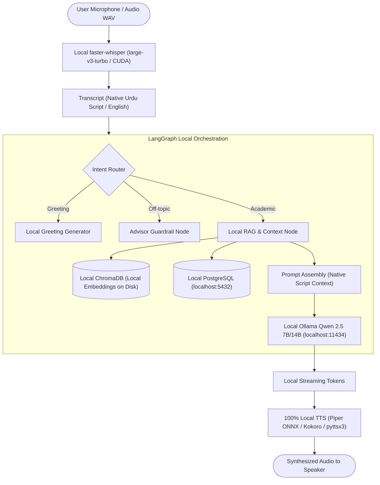

# 100% Offline GPU Architecture & Optimization Roadmap
**Project:** AI Academic Advisor (Voice, LangGraph & Knowledge Services)  
**Deployment Requirement:** **Strictly Offline / Air-Gapped** (Zero Cloud / Zero External API Dependencies)  
**Target Hardware:** Local Machine / Server with Dedicated NVIDIA GPU (CUDA)

---

## 1. System Architecture (Fully Air-Gapped)

Every stage of the voice-to-voice pipeline operates on `localhost` without internet connectivity.



---

## 2. Component Specifications (Offline Only)

### 2.1 Speech-to-Text (STT): 100% Offline Whisper on CUDA

#### Implementation
* **Backend:** `faster-whisper` running locally via CTranslate2 with CUDA `float16`.
* **Model:** `large-v3-turbo` stored directly in your local directory (`FYP2/model_cache/`).
* **Offline Guarantee:**
  * Model files (`model.bin`, `config.json`, `vocabulary.json`) are pre-downloaded to `./FYP2/model_cache/`.
  * Runtime operates with `local_files_only=True` and environment variable `HF_HUB_OFFLINE=1`.
* **Accuracy Improvements:**
  * Eliminates repetition hallucinations (`ayk ayk ayk`) common in the `base` model.
  * Captures code-switched bilingual speech (Urdu + English academic terms).
* **Domain Biasing:** Hotwords passed locally in `initial_prompt`:
  ```python
  initial_prompt = (
      "BIIT, Arid, CGPA, GPA, semester, course, prerequisite, drop, "
      "freeze, unfreeze, withdrawal, probation, cease, attendance, "
      "challan, installment, exam, mid-term, final-term"
  )
  ```
* **Performance:** ~200ms – 400ms transcription latency on local GPU.

---

### 2.2 Urdu & Roman Urdu Pipeline: Local Native Script Reasoning

#### Implementation
* **Preserve Native Script for Local LLM:**
  * When Whisper transcribes spoken Urdu, it outputs native Urdu script (e.g., `"اگر میں فیل ہو جاؤں تو کیا ہوگا؟"`).
  * Rather than stripping nuance through rule-based phonetic transliteration tables, the raw Urdu script is fed **directly to the local LLM**.
* **Prompt Instructions:**
  * The local LLM is instructed:
    > *"Analyze the query in Urdu script or English against the university policies. Output your answer strictly in conversational Roman Urdu (Latin script), keeping university academic terms (CGPA, GPA, semester, fees, exam) in English."*
* **Advantage:** Eliminates phonetic transliteration corruption while remaining completely offline.

---

### 2.3 LLM Reasoning: Local Ollama on CUDA

#### Implementation
* **Engine:** Local Ollama daemon running on `http://127.0.0.1:11434`.
* **Model:** `qwen2.5:7b-instruct` (or `qwen2.5:14b-instruct` for 16GB+ VRAM).
  * High-accuracy multilingual reasoning and strict instruction-following.
  * Runs entirely on local VRAM using 4-bit/8-bit GGUF quantization.
* **Offline Guarantee:** Pre-pulled locally via `ollama pull qwen2.5:7b-instruct`. Requires zero network access during operation.
* **Throughput on GPU:** 60 – 100+ tokens/sec.

---

### 2.4 Knowledge Retrieval: 100% Offline ChromaDB RAG

#### Implementation
* **Vector Store:** Local **ChromaDB** with persistent disk storage (`./chroma_data/`).
* **Local Embedding Model:**
  * `sentence-transformers/paraphrase-multilingual-MiniLM-L12-v2` or `BAAI/bge-m3`.
  * Model weights cached locally in `./model_cache/embeddings/`.
* **Search Strategy:**
  1. **Dense Vector Search:** Matches semantic meaning across English policies and Urdu queries without external APIs.
  2. **Sparse Lexical Search:** Matches exact codes (`"CS-301"`, `"2.50"`, `"75% attendance"`).
  3. Returns the exact matching sections from `FYP2/knowledge/biit_student_policies.md`.

---

### 2.5 LangGraph Pipeline: Local State Orchestration

#### Implementation in `FYP2/services/advisor_graph.py`
* **Intent Routing:** Evaluates queries locally into `greeting`, `irrelevant`, or `academic`.
* **Selective Context Retrieval:** Selectively loads student records from local PostgreSQL database (`localhost:5432`):
  * Personal CGPA queries $\to$ Profile & Progression records.
  * Course / Failed queries $\to$ Enrolment & Transcript records.
* **No Direct DB Short-Circuits:** Student context is passed to the LLM alongside retrieved policies so the student receives natural, reasoned explanations.

---

### 2.6 Text-to-Speech (TTS): 100% Offline Synthesis

> [!IMPORTANT]
> **Cloud TTS (such as Edge-TTS) has been completely removed.** All synthesis options listed below run entirely on local hardware with zero network connectivity.

#### Option A: Offline Neural TTS with Piper (Recommended for Speed & Quality)
* **What it is:** Ultra-lightweight local neural TTS engine running via ONNX Runtime directly on CPU or CUDA.
* **Quality:** High-quality neural speech; far superior to `pyttsx3`.
* **Model Weights:** Single small local `.onnx` file (~60 MB) placed in `./FYP2/model_cache/tts/`.
* **Voices Available:**
  * `hi_IN-hindi-medium.onnx` (natural South Asian / Hindi / Urdu pronunciation of Roman Urdu).
  * `en_US-lessac-medium.onnx` (clear English).
* **Latency:** Generates audio in under 100ms on local machine.

#### Option B: Offline Neural TTS with Kokoro-82M on CUDA
* **What it is:** 82M parameter open-source local PyTorch neural TTS model running on local GPU.
* **Quality:** Human-grade offline speech.
* **VRAM Cost:** ~0.8 GB VRAM on local GPU.

#### Option C: Native OS Synthesizer (`pyttsx3` with Local Voices)
* **What it is:** The existing solution in `FYP2/services/voice_service.py`.
* **Quality:** Uses local offline OS speech engines (NSSpeech on macOS, SAPI5 on Windows, eSpeak on Linux).
* **VRAM Cost:** 0 MB VRAM, 100% offline, zero setup required.

---

## 3. Local VRAM Allocation Budget (Offline Models on GPU)

| Component | Model & Precision | Local VRAM Footprint |
| :--- | :--- | :--- |
| **STT** | `faster-whisper large-v3-turbo` (FP16) | **~2.0 GB** |
| **LLM** | `qwen2.5:7b-instruct` (Q4_K_M GGUF via Ollama) | **~4.8 GB** |
| **Embeddings** | Local `bge-m3` or `MiniLM` (via PyTorch CUDA) | **~0.6 GB** |
| **Local TTS** | Piper (ONNX) or Kokoro-82M (CUDA) | **~0.1 GB – 0.8 GB** |
| **Total Estimated VRAM** | **All Local Engines Running Concurrently** | **~7.5 GB – 8.2 GB** |

*(If using an 8 GB GPU, Piper ONNX runs on CPU/RAM at near-zero latency, leaving ~7.4 GB VRAM for Whisper and Ollama).*

---

## 4. Offline Deployment Preparation Checklist

Before taking the machine offline:

1. **Pre-download Whisper Model:**
   ```bash
   python -c "from faster_whisper import WhisperModel; WhisperModel('large-v3-turbo', download_root='FYP2/model_cache')"
   ```
2. **Pre-download Ollama Model:**
   ```bash
   ollama pull qwen2.5:7b-instruct
   ```
3. **Pre-download Embedding Model:**
   ```bash
   python -c "from sentence_transformers import SentenceTransformer; SentenceTransformer('sentence-transformers/paraphrase-multilingual-MiniLM-L12-v2', cache_folder='FYP2/model_cache/embeddings')"
   ```
4. **Set Offline Environment Variables:**
   ```env
   HF_HUB_OFFLINE=1
   TRANSFORMERS_OFFLINE=1
   OLLAMA_HOST=127.0.0.1:11434
   STT_BACKEND=faster-whisper
   WHISPER_MODEL=large-v3-turbo
   ```
